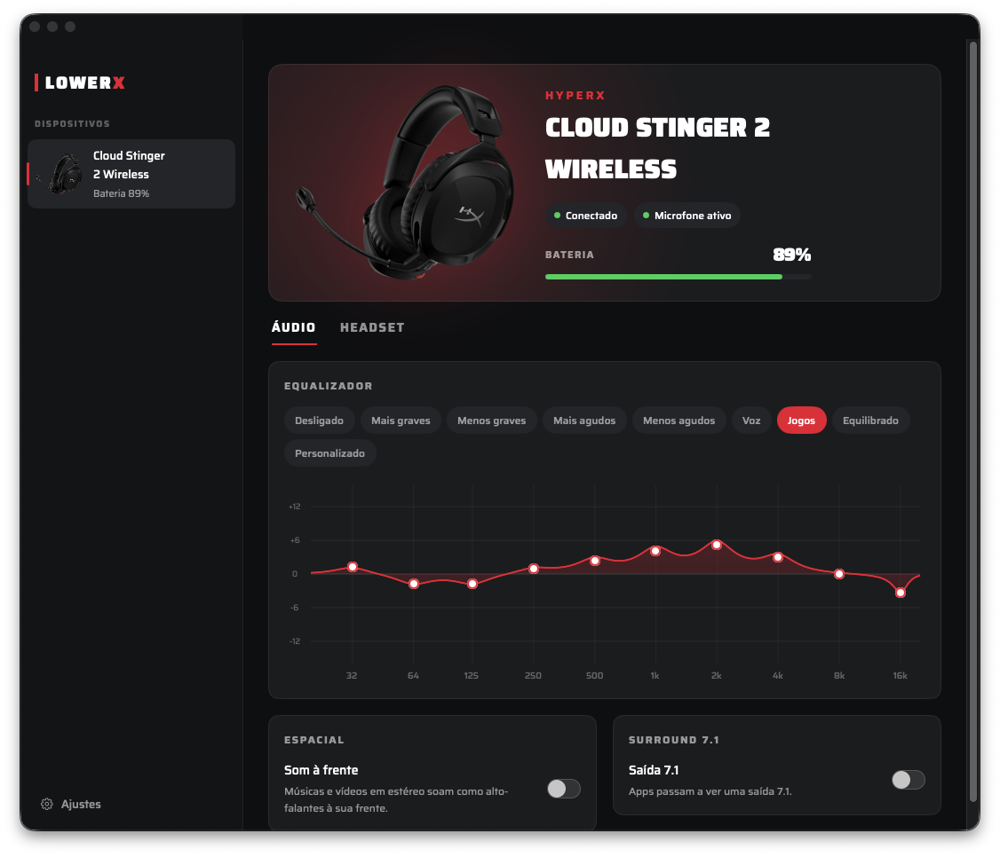
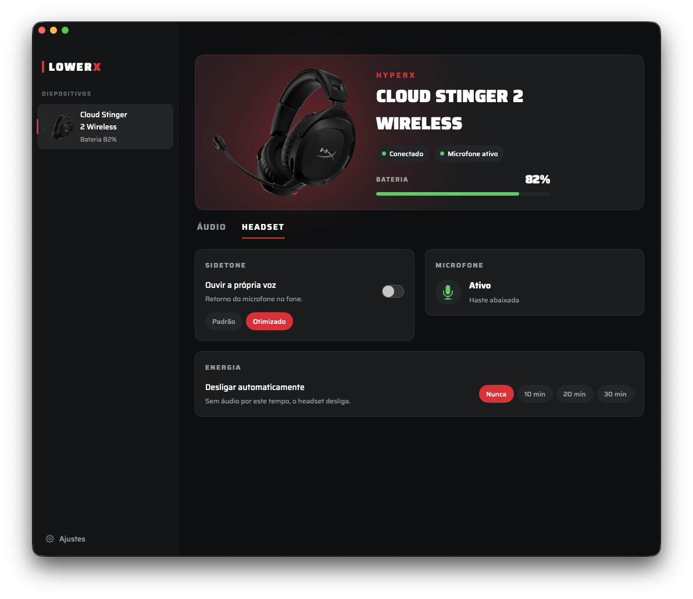
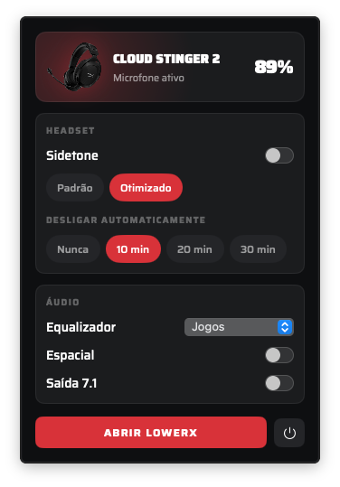
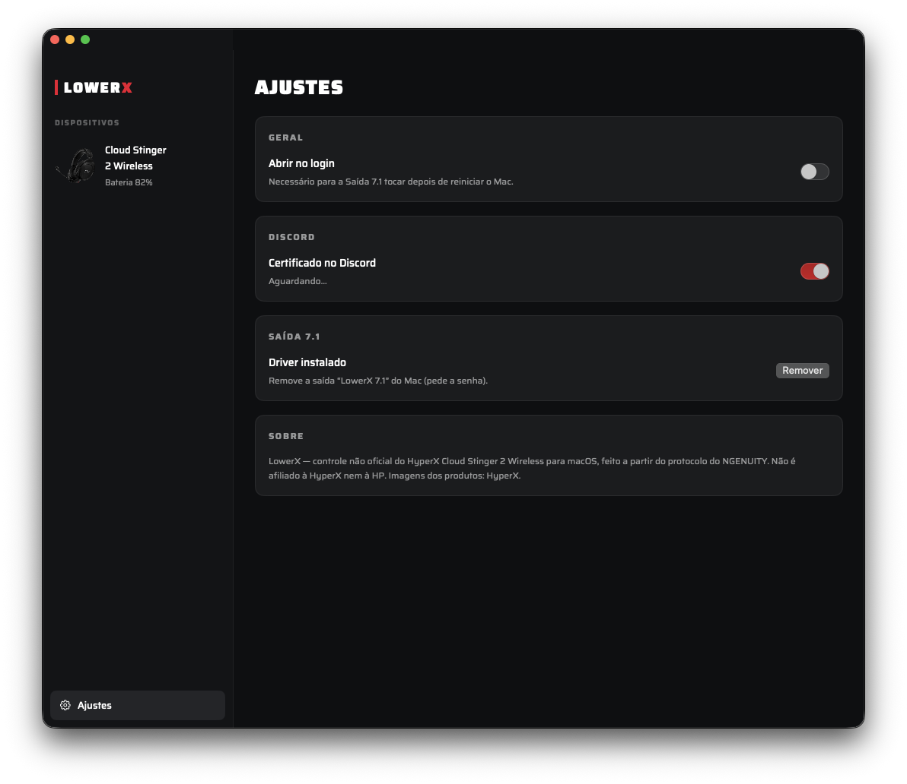

<p align="center">
  
</p>

<h1 align="center">LowerX</h1>

<p align="center">
  <a href="README.md">English</a> · <a href="README.pt-BR.md">Português</a> · <b>Español</b>
</p>

<p align="center">
  Control no oficial del <b>HyperX Cloud Stinger 2 Wireless</b> para macOS.<br>
  NGENUITY solo existe para Windows; LowerX cumple el mismo papel en el Mac.
</p>

<p align="center">
  
</p>

## Funciones

- **Batería, carga y estado del headset**, con el porcentaje en la barra de menús.
- **Micrófono**: muestra en tiempo real si está silenciado (brazo levantado).
- **Sidetone**: encendido/apagado y dos niveles, **Padrão** (Estándar, −25 dB, de fábrica) y **Otimizado** (Optimizado, −12 dB).
- **Apagado automático**: nunca, 10, 20 o 30 minutos.
- **Ecualizador de 10 bandas** con los presets oficiales de NGENUITY (Más graves, Menos graves, Más agudos, Menos agudos, Voz, Juegos, Equilibrado) y un modo personalizado: arrastra los puntos del gráfico.
- **Espacial**: la música y los videos en estéreo suenan como altavoces frente a ti (HRTF de Apple).
- **Salida 7.1**: una salida de sonido virtual de 8 canales. Los juegos y películas en 7.1 tienen cada canal ubicado en 3D en el headset.
- **Certificación en Discord**: Discord reconoce el headset, como lo hace con NGENUITY en Windows.
- **Otros dispositivos HyperX**: reconoce 56 modelos (159 IDs USB) y muestra la foto de cada uno. Todavía no tienen controles.

Por ahora la interfaz está en portugués (pt-BR). [¡Las traducciones son bienvenidas!](#contribuir)

<p align="center">
  
  
</p>

## Dispositivos compatibles

| Dispositivo | Estado |
|---|---|
| HyperX Cloud Stinger 2 Wireless | ✅ Completo |
| Otros 55 modelos HyperX (headsets, teclados, ratones, micrófonos, alfombrillas) | 🔍 Detectados con nombre y foto, aún sin controles. [¡Contribuciones bienvenidas!](#contribuir) |

## Requisitos

- macOS 14.2 o posterior.
- HyperX Cloud Stinger 2 Wireless (receptor USB `03F0:0D93`).
- Xcode (o las Command Line Tools) para compilar.

## Compilar e instalar

```sh
./build-app.sh          # compila e instala /Applications/LowerX.app
```

La app está firmada ad-hoc. La primera vez que se usa el ecualizador o el espacial, macOS pide el permiso de **grabación de audio del sistema**. La **salida 7.1** la instala la propia app (pide la contraseña de administrador).

Para que la salida 7.1 suene después de reiniciar el Mac, activa **Abrir no login** (Abrir al iniciar sesión) en Ajustes.

<p align="center">
  
</p>

## Cómo funciona

### Protocolo del headset

El protocolo se reconstruyó a partir de `NGenuity2Helper.exe` (parte del instalador de NGENUITY 2.38) y se comprobó en el dispositivo. Todo pasa por reports HID de 20 bytes en la colección vendor `0xFF90`/`0x0303`, con el formato `06 FF BB <cmd> <valor>`:

| cmd | función | respuesta |
|---|---|---|
| `01` | estado | `r[4]` = 1 o 4: headset encendido; 3: apagado |
| `02` | batería | `r[7]` = % |
| `03` | carga | 1 cargando · 2 completa · 3 error |
| `05` | micrófono | 1 = silenciado |
| `06` / `21` | leer / encender sidetone | |
| `07` / `22` | leer / definir apagado automático (min) | |
| `0B` / `23` | leer / definir nivel del sidetone (dB con signo) | |
| `20` | evento espontáneo del brazo del micrófono | 1 = silenciado |

Los comandos de escritura devuelven `cmd valor 01` a todos los programas conectados. El nivel del sidetone solo se aplica cuando se enciende el sidetone, por eso la app lo apaga y lo vuelve a encender al cambiar el nivel.

> ⚠️ El nivel del sidetone es una ganancia en dB con signo: los valores positivos amplifican mucho (`0x20` = +32 dB es ensordecedor). La app solo envía los dos niveles probados.

### Ecualizador y espacial

En Windows, el EQ y el espacial son DTS Headphone:X, un efecto de audio del sistema; nada de eso corre en el headset. En el Mac:

1. Un **process tap** de Core Audio (macOS 14.2+) captura el audio que las apps envían al headset y silencia el original.
2. Un aggregate device privado une el tap y el headset; su IOProc procesa y reproduce el resultado.
3. Cadena: origen → espacial (`AUSpatialMixer`, HRTF) → EQ (10 biquads por canal, preganancia anti-clipping) → headset.

Si la app se cierra, el tap desaparece y el sonido vuelve a la normalidad.

En el modo espacial, lo que es igual en los dos canales va solo a un altavoz virtual central. Reproducir la misma señal en dos altavoces virtuales crea huecos en el espectro (−15 dB en 2 kHz) y hace que todo suene apagado.

### Salida 7.1

`Driver/LowerX71.c` es un driver AudioServerPlugIn propio: una salida de 8 canales (L R C LFE Ls Rs Rls Rrs) que solo proporciona el reloj y descarta el audio. La app captura esa salida con el mismo tap y ubica cada canal: frontales a ±30°, central a 0°, laterales a ±90° y traseros a ±150°. Cuando una app envía solo estéreo, el ajuste espacial decide cómo suena.

### Discord

La app llama al RPC local de Discord (`127.0.0.1:6463–6472`) con `SET_CERTIFIED_DEVICES` y el `client_id` de HyperX, usando el UID de Core Audio del headset, igual que NGENUITY.

## Estructura

```
Sources/LowerX/
  StingerProtocol.swift   comandos y respuestas del headset
  HIDTransport.swift      IOHIDManager
  HeadsetModel.swift      estado y cola de comandos (120 ms entre envíos)
  SystemAudioEQ.swift     tap + aggregate device + cadena de efectos
  SpatialRenderer.swift   upmix y AUSpatialMixer
  Equalizer.swift         presets y filtros
  AudioEffects.swift      cuándo activar el pipeline, salida 7.1, permisos
  DiscordCertifier.swift  certificación en Discord
  USBDeviceWatcher.swift  otros dispositivos HyperX (IOKit, sin permiso de monitoreo de entrada)
  DeviceCatalog.swift     generado desde tools/
  MainWindow.swift, LowerXApp.swift, Theme.swift, EqualizerGraph.swift   interfaz
Driver/                   salida virtual 7.1
tools/                    scripts para regenerar el catálogo, las imágenes y el icono
```

### Herramientas

| script | qué genera |
|---|---|
| `tools/extract_catalog.py` + `tools/gen_catalog_swift.py` | `DeviceCatalog.swift`, a partir de `NGenuity2Helper.exe` descompilado con `ilspycmd` |
| `tools/prepare_device_images.py` | `Assets/Devices`, una imagen por modelo, a partir de `Assets/Devices` del paquete de NGENUITY |
| `tools/make_icon.swift` | `Assets/AppIcon.icns` |

## Contribuir

¡Las mejoras son muy bienvenidas, y los pull requests también! 🙌

Algunas ideas:

- **Otros dispositivos HyperX.** Los protocolos están en NGENUITY: descompila `NGenuity2Helper.exe` con `ilspycmd`; las clases de cada dispositivo están en `NGenuity2.Devices.*`. Si tienes el dispositivo, impleméntalo, pruébalo y envía un PR. Empieza por las lecturas (batería, estado) antes de los comandos de escritura.
- **EQ, espacial y salida 7.1 para cualquier auricular**, no solo el Stinger 2.
- **Traducciones de la interfaz**, que por ahora está en portugués.
- **Errores y sugerencias**: abre un issue.

Al enviar un PR, cuenta qué probaste y en qué dispositivo y versión de macOS. No incluyas archivos del instalador ni código descompilado de NGENUITY.

> ⚠️ Cuidado al probar comandos de escritura: las ganancias pueden estar en dB (el sidetone a +32 dB fue ensordecedor). Empieza con valores bajos y el headset lejos de los oídos.

## Créditos

- Imágenes de los productos: **HyperX**, de los materiales de prensa de cada producto.
- Fuente [Saira](https://github.com/Omnibus-Type/Saira), licencia SIL Open Font License (`Assets/Fonts/OFL.txt`).
- HyperX, NGENUITY y Cloud Stinger son marcas de HP Inc. LowerX es un proyecto independiente, sin afiliación con HyperX ni HP.
